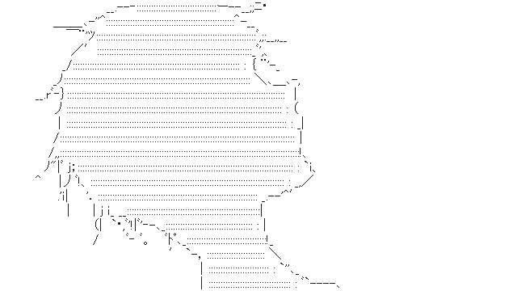
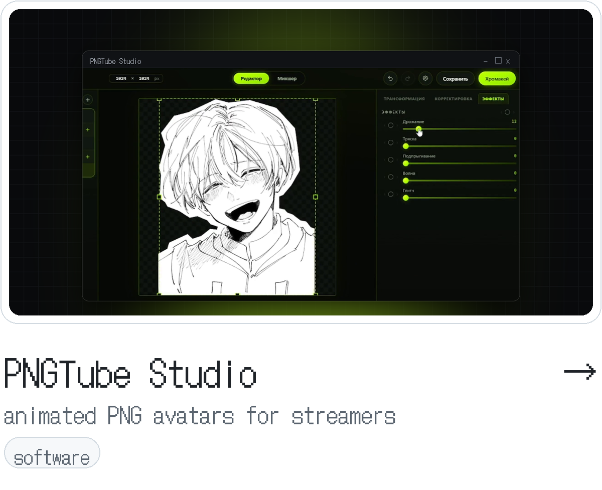
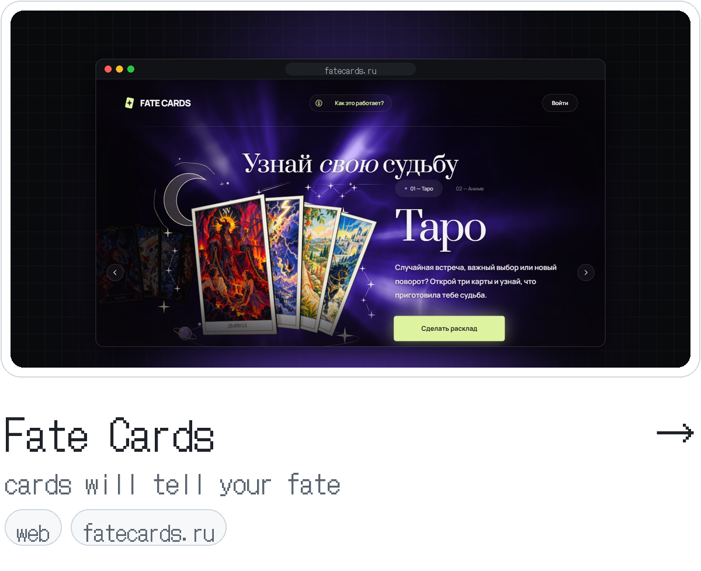

<picture>
  <source media="(prefers-color-scheme: dark)" srcset="assets/head-dark.gif">
  
</picture>

「 あなたと一緒に桜を鑑賞したいです。 」

 

<a href="https://luxeny.github.io">Portfolio</a>&nbsp;&nbsp;&nbsp;・&nbsp;&nbsp;&nbsp;<a href="https://plusvibestudio.ru">+VibeStudio</a>&nbsp;&nbsp;&nbsp;・&nbsp;&nbsp;&nbsp;<a href="https://t.me/luxeny">Telegram</a>

  

─────&nbsp;&nbsp;projects&nbsp;&nbsp;─────

 

<a href="https://plusvibestudio.ru/projects/pngtube-studio"><picture><source media="(prefers-color-scheme: dark)" srcset="assets/card-pngtube-dark.png"></picture></a>&nbsp;&nbsp;<a href="https://fatecards.ru"><picture><source media="(prefers-color-scheme: dark)" srcset="assets/card-fatecards-dark.png"></picture></a>

